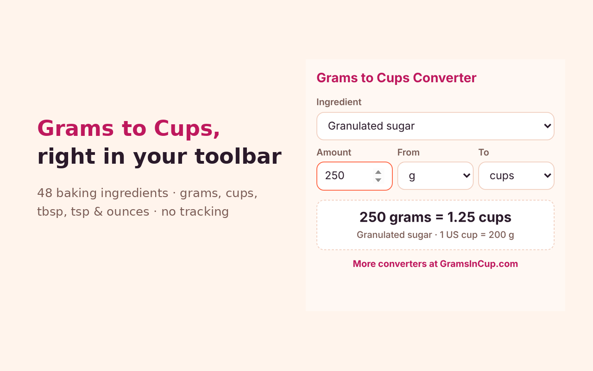

# Grams to Cups Converter (browser extension + embeddable widget)

A tiny, open-source **grams to cups converter** for baking. Convert grams to cups, tablespoons, teaspoons and ounces for 48 common ingredients, including all-purpose flour, sugar, brown sugar, butter, rice, oats, honey and cocoa powder.

This is the open-source browser extension behind **[GramsInCup](https://gramsincup.com/)**, a free grams-to-cups conversion site with ingredient charts and baking guides.



## Why ingredient-specific?

A cup is a measure of volume and a gram is a measure of weight, so there is no single "grams in a cup" number. 1 cup of all-purpose flour is about 125 g, while 1 cup of granulated sugar is about 200 g. This converter stores a grams-per-cup value for each ingredient and does the maths for you.

Full charts for every ingredient: [How many grams in a cup](https://gramsincup.com/blog/how-many-grams-in-a-cup).

## Features

- 48 baking ingredients with their own densities
- Grams ↔ cups, tablespoons, teaspoons and ounces
- Results update as you type
- Works offline: no permissions, no network requests, no tracking
- Uses US customary cups (236.6 ml)

## Install

- **Firefox:** [addons.mozilla.org/firefox/addon/gramsincup](https://addons.mozilla.org/firefox/addon/gramsincup/)
- **Microsoft Edge:** Edge Add-ons listing (in review)
- **Manual (Chrome, Edge, Brave):** download this repo, open `chrome://extensions`, turn on *Developer mode*, click *Load unpacked* and pick the `extension` folder. Chrome may warn about the Firefox-only `browser_specific_settings` key in `manifest.json`; it is safe to ignore or delete.

## Embed the converter on your own site

There is also a free embeddable widget for food blogs and recipe sites. Get the copy-paste code here: **[gramsincup.com/converter-widget](https://gramsincup.com/converter-widget)**.

```html
<iframe src="https://gramsincup.com/embed/converter" title="Grams to cups converter"
  width="100%" height="340" style="max-width:440px;border:0" loading="lazy"></iframe>
<p>Grams to cups converter by <a href="https://gramsincup.com/">GramsInCup</a></p>
```

## Project structure

```
extension/
  manifest.json   Manifest V3
  popup.html      Popup markup
  popup.css       Styles
  popup.js        Conversion logic (no inline scripts)
  data.js         Ingredients: [key, name, grams per US cup]
  icons/          16–128 px icons
```

## Unit constants

| Unit | Relative to 1 US cup |
|---|---|
| Tablespoon | 1/16 cup |
| Teaspoon | 1/48 cup |
| Ounce (weight) | 28.3495 g |

## Contributing

Spotted an ingredient value that looks off, or want a new ingredient? Open an issue or a pull request with a source.

## License

MIT. See [LICENSE](LICENSE).

---

Made by [GramsInCup](https://gramsincup.com/): free kitchen conversions, charts and baking guides.
